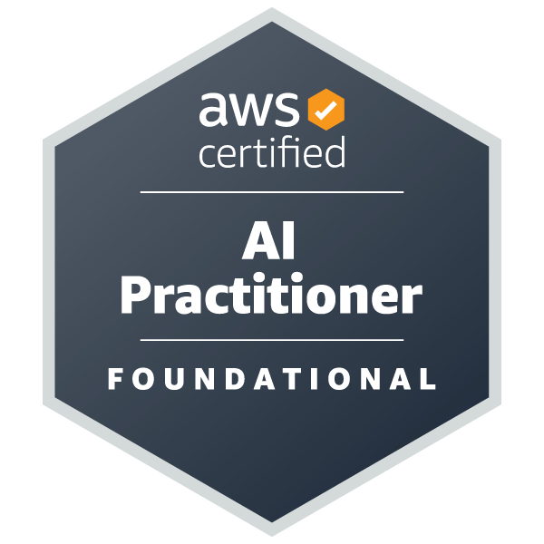

# ⚙️ Solutions architect & backend engineer

**“Simple is complex enough” is something I believe applies to both technology and music. Whether it’s system design, software development, or playing the drums, I focus on clarity, simplicity, and building strong fundamentals.**

I work with cloud architecture, infrastructure, automation, and backend systems, with a particular focus on AWS. I like working with the bigger picture, understanding how the pieces fit together, and building things that stay reliable and maintainable as they grow.

## Selected portfolio projects

| Project | Focus | Tech stack |
| :-: | - | - |
|  | Serverless Transport for London (TfL) fare optimization app with Terraform IaC and automated CI/CD | Python, FastAPI, AWS Lambda, API Gateway, Terraform, GitHub Actions |
| [Kubernetes Lab](https://github.com/wahreus/kubernetes-lab) | Kubernetes administration, networking, and troubleshooting | Amazon EC2, Terraform, Kubernetes, Docker, Helm |
| [Cloud Cost Analytics](https://github.com/wahreus/cloud-cost-analytics) | FinOps-style SQL analysis using cloud cost data | AWS, Terraform, MySQL, SQL |
| [Daily Tip Agent](https://github.com/wahreus/daily-tip-agent) | RAG-based agent for generating daily AWS best-practice tips | Python, OpenAI API, SQLite, GitHub Actions |
| [Noughts and Crosses](https://github.com/wahreus/noughts-and-crosses) | Serverless browser game with cloud-hosted frontend and API | AWS, Terraform, S3, CloudFront, API Gateway, Lambda, DynamoDB |

## Active Certifications

  
  
  

